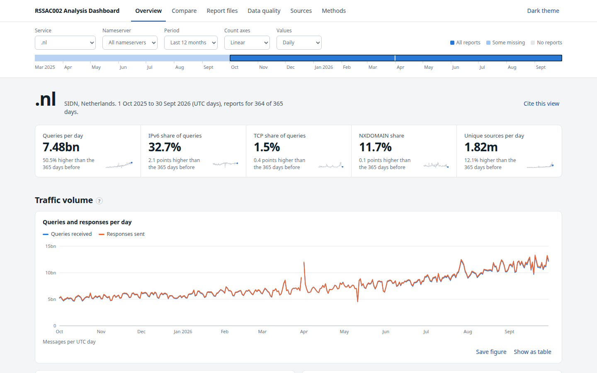
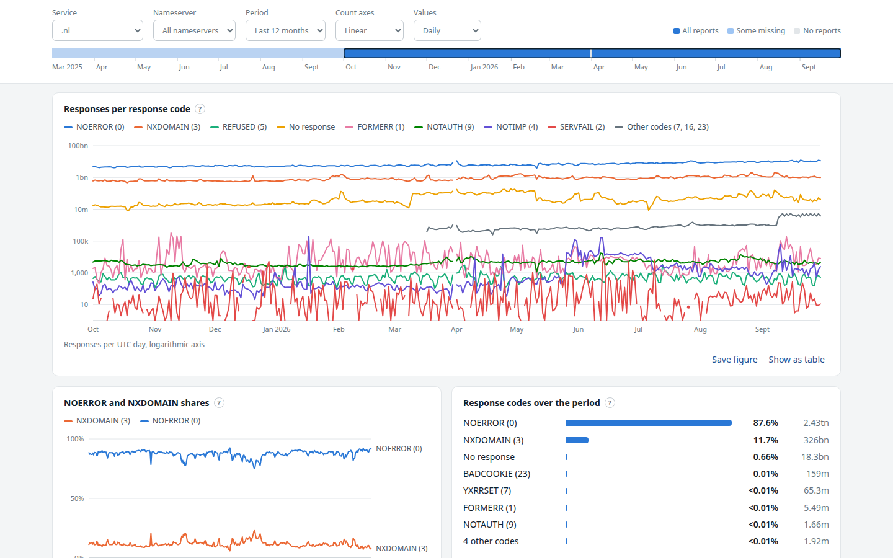
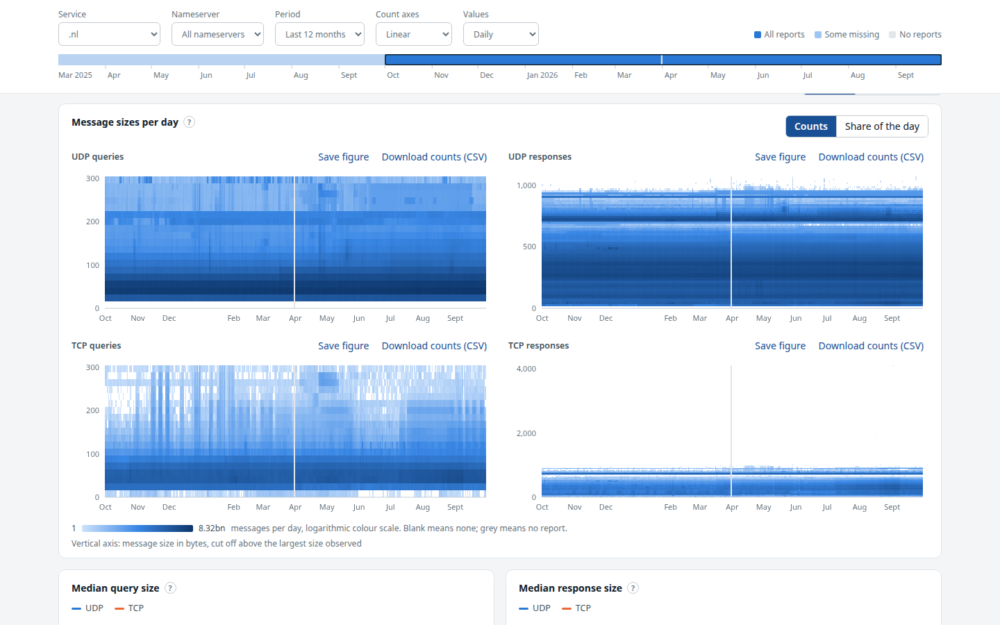
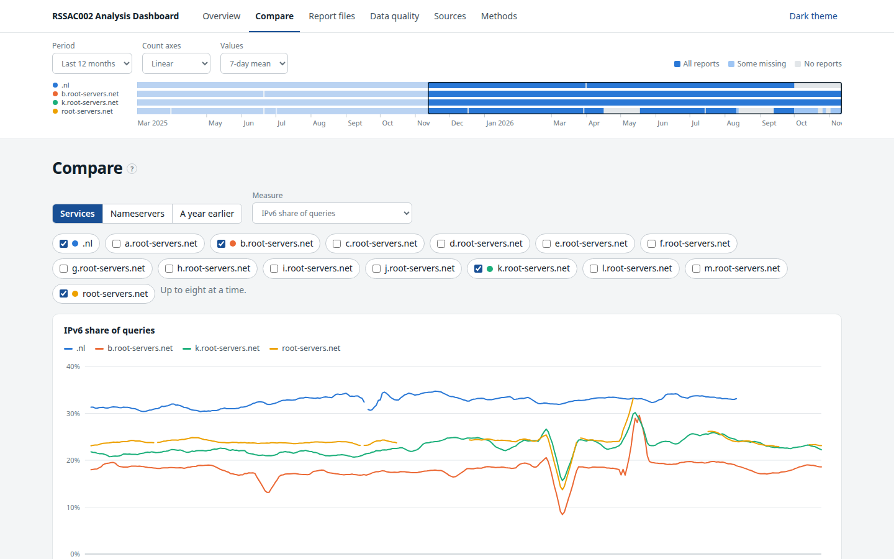
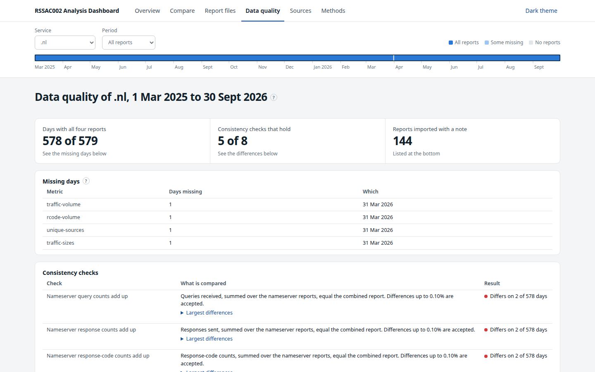

# RSSAC002 Analysis Dashboard v2

A web dashboard for exploring RSSAC002 DNS traffic reports from TLD registries and root server operators: traffic volume, response codes, message sizes and unique sources, per service and per nameserver.

**Live demo: [rssac002.jorrit.io](https://rssac002.jorrit.io)**



It is one process with one SQLite file. The charts are drawn by the dashboard itself, with no external services.

## Features

- **Overview** of one service: every RSSAC002 traffic metric in charts, with a timeline of which days have reports.
- **Compare** services, the nameservers of one service, or a period with the year before.
- **DNS over TLS and QUIC**, which RSSAC002 does not cover, for operators that report them in fields of their own, such as b and h root.
- **Data quality**: missing days and consistency checks on the reports.
- **Report files**: read or download the original YAML, also served under `/rssac002/` in the standard layout.
- **For research**: logarithmic axes, 7-day means, summary statistics, CSV and figure export, a citation for each view, and a Methods page that defines every measure.

| | |
|---|---|
|  |  |
|  |  |

## Run it

You need [uv](https://docs.astral.sh/uv/) and Git.

```sh
uv sync
uv run rssac002-dashboard import sidn-nl                           # .nl, from github.com/SIDN/nl-rssac002
uv run rssac002-dashboard import root-servers --since 2025-03-01   # the 13 root servers and their total
uv run rssac002-dashboard serve                                    # http://127.0.0.1:8000
```

Or with Docker: `cp .env.example .env && docker compose up --build`, then run the import commands inside the container with `docker compose exec dashboard rssac002-dashboard import sidn-nl`.

New reports are fetched every six hours while it runs.

## Other sources

Any Git repository, web directory listing or local folder in the RSSAC002 publication layout can be added, including the output folder of the [ENTRADA RSSAC002 metrics generator](https://github.com/SIDN/entrada-rssac002):

```sh
uv run rssac002-dashboard add https://github.com/operator/reports --name .example --short-service example
uv run rssac002-dashboard add /srv/NL-RSSAC002-data --name .nl --short-service nl
```

`rssac002-dashboard --help` lists the other commands. To add a publisher by name, like the two above, add an entry to [`rssac002_dashboard/importers.py`](rssac002_dashboard/importers.py).

To manage sources in the browser, set an admin password: see [`.env.example`](.env.example).

## Development

```sh
uv run pytest
uv run ruff check .
```

## Credits and licence

This is the second version of the [RSSAC002 Analysis Dashboard](https://codeberg.org/RSSAC002-TLD/RSSAC002-Analysis-Dashboard), which was built as a TU Delft CSE2000 Software Project for SIDN Labs.

The screenshots show data published by [SIDN](https://github.com/SIDN/nl-rssac002) and by the root server operators, as collected by the [RSSAC Caucus](https://github.com/rssac-caucus/RSSAC002-data).

Licensed under the GNU General Public License, version 3. See [`LICENSE`](LICENSE).
